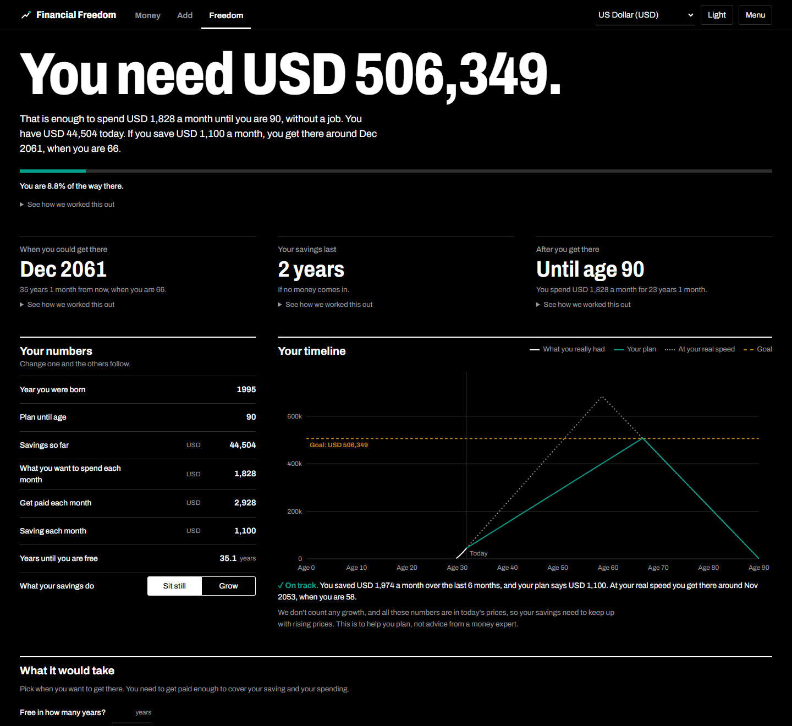
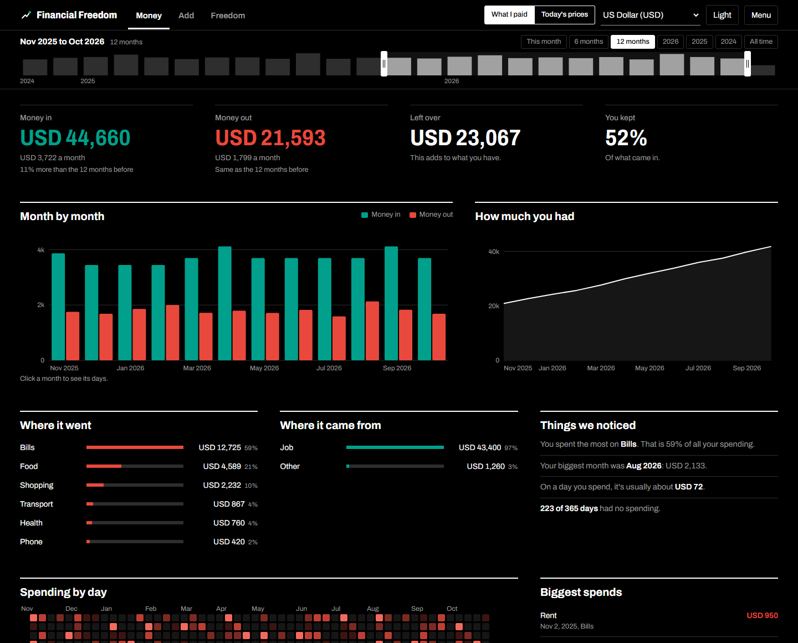
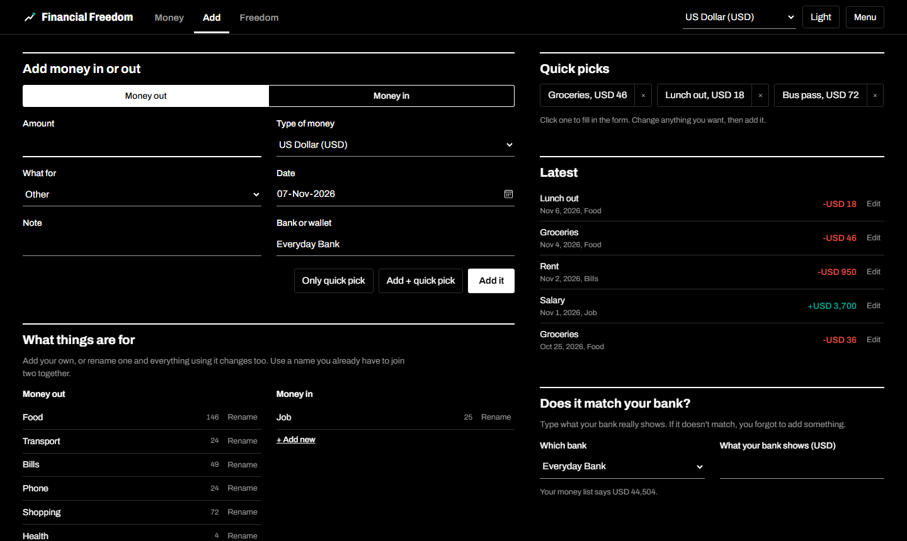
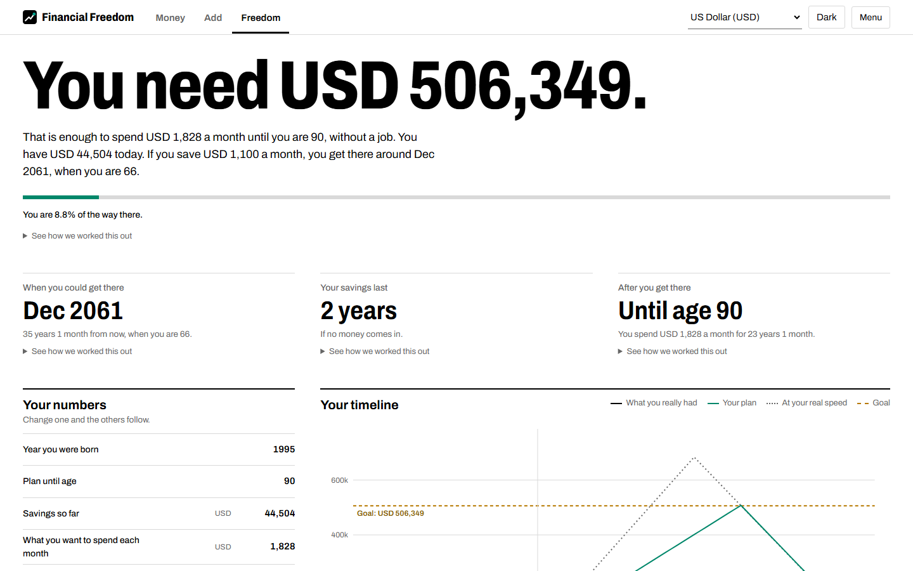
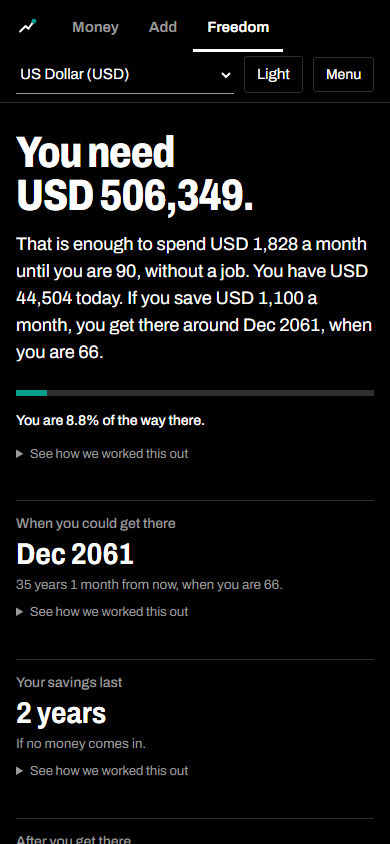

# Financial Freedom

See where your money goes, and how much you need so you never have to work for money again. It runs entirely in your browser, with no build step and no account.

**[Open the app](https://ibrahimahtsham.github.io/financial-freedom/)**



*All the numbers in these pictures are made up.*

## Use it

Open it at https://ibrahimahtsham.github.io/financial-freedom/, or double-click `index.html`. Your numbers stay in that browser, so use **Menu > Save my plan** to keep a copy.

## How it works

- **Money:** what came in, what went out, and where it went, in any currency and optionally in today's prices.
- **Add:** write down money in or out, with quick picks, a check against your bank, and renaming.
- **Freedom:** your goal, when you could reach it and how long your savings last, each with its sum. Savings sit still unless you choose Grow and set a yearly guess.





It comes in dark and light, and works on a phone.





Each transaction keeps its own currency. Totals convert at today's rate, and today's prices apply each currency's own yearly inflation first.

Only exchange rates and inflation are fetched from the internet, from free services that need no key. Your data is never sent anywhere.

The full version with life stages, moving and rules is kept at the git tag `v1-full`.

## Project layout

```
index.html        Page structure
assets/           Favicon and README pictures
css/              tokens (colours), layout, components
js/
  config.js       Constants
  engine.js       Planning maths, with no DOM or app state
  store.js        Saved data and validation
  rates.js        Exchange rates and inflation
  format.js       Display and currency helpers
  charts.js       SVG charts
  range.js        Timeline slider
  views/          Money dashboard, money list, Add page, Freedom
  tutorial.js     First-run walkthrough
  app.js          Startup and tab switching
tests/            Tests for the planning maths
private/          Personal data, ignored by git
```

The scripts are plain files loaded in order rather than ES modules, because browsers block modules on pages opened straight from disk.

## Tests

```
npm test
```

## Privacy

Never commit bank statements or plan files. `.gitignore` covers `private/`, `*.csv`, `*.pdf` and saved plan files.
